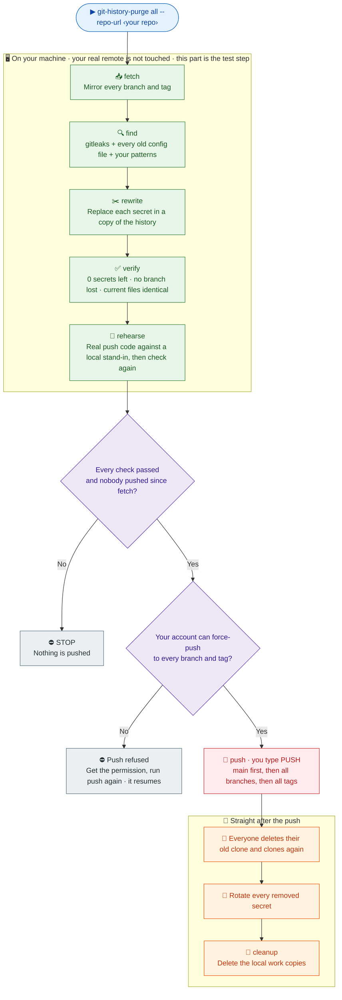
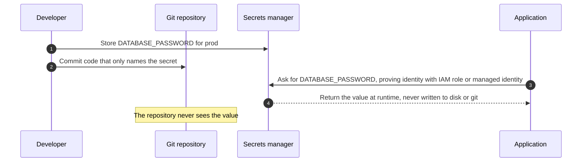
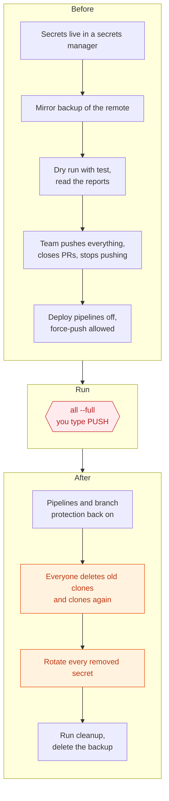
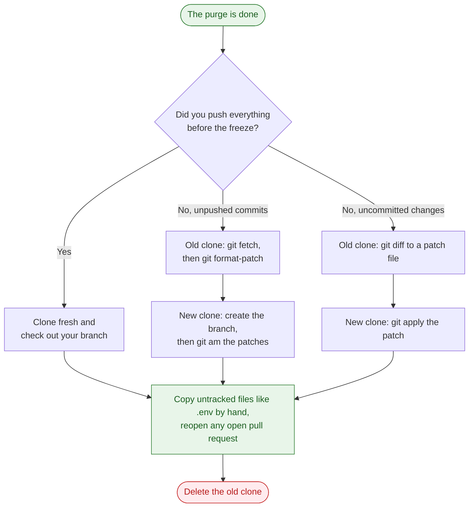

# Remove secrets from git history: passwords, API keys and .env files

[](https://github.com/BrienAustinClayton/remove-secrets-from-git-history/actions/workflows/ci.yml)
[](LICENSE)
[](https://www.python.org/downloads/)
[](#install)

**Did a `.env` file, a password or an API key end up in git?** It happens to almost every team. Deleting the file in a new commit doesn't help, because the secret is still in every earlier commit.

`git-history-purge` finds every leaked secret across your **entire git history**, removes it from every commit, branch and tag, and then force-pushes the cleaned history to GitHub, GitLab, Azure DevOps, Bitbucket or any other git server. It checks its own work at every step before it touches your real remote.

- 🔍 **Finds the secrets for you.** It runs a gitleaks scan of the whole history, reads every old version of your `.env`, `.properties`, `.ini`, `.tfvars` and YAML config files, and applies any regex patterns you add.
- 🛡️ **Safe by design.** A dry run, a verification step and a full push rehearsal against a local copy all happen before anything reaches your real remote.
- ✅ **Keeps today's code working.** Values still used on your main branch are never replaced, and your current files stay byte-identical.
- 📄 **No config file, no runtime dependencies.** Works on any repository in any language. The only thing it needs is the repository URL.
- 🧩 **Small, readable codebase.** Pure Python standard library, one module per step, so you can check exactly what it does before you trust it with your repository.
- 💻 **Cross-platform.** Runs on Windows, macOS and Linux.

It's built on [git-filter-repo](https://github.com/newren/git-filter-repo), the tool the git project recommends instead of `git filter-branch`, and on [gitleaks](https://github.com/gitleaks/gitleaks).

> [!CAUTION]
> **Rewriting history changes every commit ID. After the purge, everyone on the team must delete their old clone and clone the repository again.**
> A single `git pull` or `git push` from an old clone brings the old history, secrets included, straight back. See [After the purge](#after-the-purge-what-every-developer-does).

## How it works at a glance



Everything in the top box runs on your machine and never touches your real remote. Only the red step changes the remote. It won't run until every check and the rehearsal have passed, and it needs an account that's allowed to force-push.

### Contents

- [Read this before you start](#read-this-before-you-start)
- [Keeping secrets out of code: the secrets manager approach](#keeping-secrets-out-of-code-the-secrets-manager-approach)
- [Install](#install) · [Quick start](#quick-start) · [What it does](#what-it-does) · [Options](#options)
- [Running the real purge](#running-the-real-purge) · [After the purge](#after-the-purge-what-every-developer-does)
- [Compared with BFG Repo-Cleaner and plain git filter-repo](#compared-with-bfg-repo-cleaner-and-plain-git-filter-repo)
- [FAQ](#faq) · [Project structure](#project-structure) · [Contributing](#contributing) · [License](#license)

---

## Read this before you start

There are four things to get right. Skip any of them and the purge won't protect you.

### 1. Move your secrets to a secrets manager first

> [!IMPORTANT]
> Purging git history only helps once the secrets **stop living in the code**. The script deliberately **keeps** any value that's still on your current branch, because replacing it would break your running applications. If you skip this step, those secrets stay in git.

Before you run the script:

1. Put every secret your applications still need into a secrets manager. See [Keeping secrets out of code](#keeping-secrets-out-of-code-the-secrets-manager-approach) for how that works and which services offer one.
2. Change your applications to read secrets from there instead of from files committed to git.
3. Deploy, and check that every environment runs on the secrets manager.
4. Remove the secret values from the current code (`.env` files, config files, scripts) and add `.env*` to `.gitignore`.

Only then purge the history.

### 2. A purge is not a fix: rotate every secret

> [!WARNING]
> Once a secret has been pushed, treat it as leaked. **Rotate (change) every secret the script removes.** The purge keeps your history clean from now on, and rotation makes the leaked values useless.

Even after the purge, the old values still exist in:

- every developer's old clone and every fork,
- pull request pages on your hosting service (they keep the commits every PR ever pointed to),
- CI caches, build logs and backups.

### 3. Everyone must re-clone

> [!CAUTION]
> **Every commit ID changes.** Plan a short freeze, tell your team in advance, and make sure nobody pushes from an old clone afterwards. One push from an old clone puts every secret back on the remote. The steps for developers are in [After the purge](#after-the-purge-what-every-developer-does).

### 4. You need force-push permission on every branch and tag

> [!WARNING]
> **The developer who runs the push must be allowed to force-push to every branch and tag, including protected ones like `main`.** Most hosts block this by default, so ask your repository admin to grant it *before* the purge day.
> If the permission is missing, the push is refused. The script pushes `main` first, so a refusal there leaves the remote unchanged, and a refusal on a later branch resumes when you run `push` again. Either way, your team sits in the freeze while you wait for access.

What to turn on, temporarily, for the account that pushes:

| Host | Where |
|---|---|
| GitHub | Branch protection or rulesets: allow force pushes for that account, and lift any tag ruleset that blocks updates |
| GitLab | Protected branches: allow force push, or temporarily unprotect the branches; same for protected tags |
| Azure DevOps | Repository security: **Contribute**, **Force push (rewrite history, delete branches and tags)** and **Bypass policies when pushing** |
| Bitbucket | Branch restrictions: allow **rewriting branch history** for that account |

Turn the protection back on as soon as the push is done.

---

## Keeping secrets out of code: the secrets manager approach

When a secret is written in code, a committed `.env` file or a config file, it gets copied into every clone, fork, CI cache and backup, and it stays in git history forever. A secrets manager keeps the value in one central, access-controlled place instead. Your application asks for it **at runtime**, so the repository only ever holds the secret's *name*, never its value.



### How it works

1. **Store** each secret once per environment under a clear name, for example `myapp/prod/DATABASE_PASSWORD`.
2. **Grant access by identity, not by password.** The app proves who it is with the platform's own identity: an AWS IAM role, an Azure managed identity, a GCP service account or a Kubernetes service account. No static credential is needed to fetch the secrets.
3. **Deliver the value at runtime**, in one of two ways:
   - *The app fetches it* with the provider's SDK at startup and caches it in memory.
   - *The platform injects it* as environment variables or a mounted file just before the app starts (Kubernetes External Secrets Operator, the Secrets Store CSI driver, ECS/App Service/Cloud Run secret references, CI/CD secret variables). The app keeps reading `process.env`, but the value never touches the repository.
4. **Rotate** a secret by changing it in the manager and restarting or reloading the app. No code change, no commit.
5. **Audit** who used which secret and when, because every read and change is logged.

For local development, give each developer their own non-production values. That can be an untracked `.env` file (with `.env*` in `.gitignore` and a committed `.env.example` with empty values), or a CLI that pulls dev secrets on demand (`doppler run`, `infisical run`, `op run`, `aws secretsmanager get-secret-value`).

### Services that provide it

| Service | Type | Good fit when |
|---|---|---|
| AWS Secrets Manager | Cloud (AWS) | Apps run on AWS; built-in rotation for RDS and other AWS databases |
| AWS SSM Parameter Store (SecureString) | Cloud (AWS) | Cheaper AWS option for config plus a few secrets, no built-in rotation |
| Azure Key Vault | Cloud (Azure) | Apps run on Azure; also stores keys and certificates |
| Google Cloud Secret Manager | Cloud (GCP) | Apps run on GCP (Cloud Run, GKE, Cloud Functions) |
| HashiCorp Vault / OpenBao | Self-hosted or managed | Multi-cloud or on-premises; dynamic short-lived database credentials |
| Doppler | SaaS | One dashboard syncing secrets to many clouds, CI systems and local dev |
| Infisical | SaaS or self-hosted (open source) | Doppler-style workflow you can host yourself |
| 1Password Secrets Automation / Bitwarden Secrets Manager | SaaS | The team already uses that password manager |
| Akeyless, CyberArk Conjur | SaaS / enterprise | Enterprise compliance and centralised policy |
| GitHub Actions secrets, GitLab CI variables, Azure DevOps variable groups | CI/CD | Secrets needed only by the build and deploy pipeline |
| Kubernetes External Secrets Operator | Bridge | Syncs any of the managers above into Kubernetes `Secret` objects |
| SOPS, Sealed Secrets | Encrypted in git | You want secrets versioned in git, but only in encrypted form |

> [!NOTE]
> Plain Kubernetes `Secret` objects and CI variables deliver secrets, but they aren't full secrets managers: they're only base64-encoded or scoped to one pipeline. For production, pair them with one of the managers above.

---

## Install

You'll need Python 3.11+, git 2.45+, git-filter-repo and gitleaks 8.19+.

**macOS**

```
brew install python git git-filter-repo gitleaks
```

**Windows** (PowerShell)

```
winget install Python.Python.3.12 Git.Git gitleaks
```

```
pip install git-filter-repo
```

**Linux** (Debian/Ubuntu shown; use your own package manager)

```
sudo apt install python3 python3-pip git
```

```
pip install git-filter-repo
```

Then install gitleaks from its GitHub releases page: https://github.com/gitleaks/gitleaks/releases

Check that everything is in place:

```
python3 --version && git --version && git filter-repo --version && gitleaks version
```

### Install git-history-purge

The easiest way is [pipx](https://pipx.pypa.io/), which gives you a `git-history-purge` command in its own isolated environment:

```
pipx install git+https://github.com/BrienAustinClayton/remove-secrets-from-git-history.git
```

```
git-history-purge --version
```

Prefer not to install anything? Clone the repository and run it as a module from the clone. Use `python3 -m git_history_purge` wherever this page says `git-history-purge`:

```
git clone https://github.com/BrienAustinClayton/remove-secrets-from-git-history.git
```

```
cd remove-secrets-from-git-history && python3 -m git_history_purge --help
```

On Windows, use `python` instead of `python3` in every command on this page.

---

## Quick start

Replace `<repo-url>` with your repository URL. HTTPS, SSH and local paths all work.

**1. Do a dry run.** It's safe and never changes your remote:

```
git-history-purge test --repo-url <repo-url>
```

**2. Read the reports** in `purge-work/<repo-name>/reports/`. They list key names and value lengths only, never the values themselves.

**3. Do the real run.** It runs the dry run again, then asks you to type `PUSH`:

```
git-history-purge all --repo-url <repo-url>
```

**4. Delete the local work copies**, because they still contain the original secrets:

```
git-history-purge cleanup --repo-url <repo-url>
```

To see every option:

```
git-history-purge --help
```

> [!TIP]
> Use the **same `--repo-url` and options** for every command in one purge.

---

## Try it on a local copy first (recommended)

This runs the whole flow, push included, without touching your real remote:

```
git clone --mirror --ref-format=reftable <repo-url> local-copy.git
```

```
git-history-purge all --repo-url local-copy.git
```

---

## What it does

| Step | What happens | Changes your remote? |
|---|---|---|
| `fetch` | Downloads every branch and tag. Drops read-only pull-request refs (`refs/pull/*`) | no |
| `find` | Finds every secret value: gitleaks over all history, every old version of `.env`, `.properties`, `.ini`, `.cfg`, `.conf`, `.tfvars` and config-like YAML files (`*config*`, `*secret*`, `*settings*`, `application*`, `*credential*`, `values*`, `*compose*`), and your extra patterns. Values still on your current branch are kept | no |
| `rewrite` | Rewrites a copy of the history with git-filter-repo: file contents and commit messages | no |
| `verify` | Checks: 0 secret values left, no branch or tag lost, current branch files byte-identical | no |
| `rehearse` | Pushes to a **local stand-in** with the real push code, clones it fresh and checks again | no |
| `push` | Force-pushes the current branch first, then all branches, then all tags. Asks you to type `PUSH` | **yes** |
| `cleanup` | Deletes the work folder. Asks you to type `DELETE` | no |
| `test` | `fetch` → `find` → `rewrite` → `verify` → `rehearse` | no |
| `all` | `test` + `push` | **yes** |

Each secret is replaced with a marker such as `[SECRET REMOVED FROM GIT 2026-11-18 18:14 UTC]`.

### Built-in safety

The push step is deliberately hard to run by accident:

- `push` refuses unless `rehearse` passed for this exact rewritten copy.
- `push` refuses if the URL differs from the one `fetch` used, so a local test can never push to the real remote.
- `push` refuses if anyone pushed to the remote after `fetch`.
- The current branch is pushed first with `--force-with-lease`. If that's refused, nothing else is pushed.
- If a push is interrupted or partly refused, running `push` again resumes it.
- Before asking for `PUSH`, it lists the open pull requests that will keep the old history reachable.

---

## Public keys in your repo: keeping or ignoring them

Some values in a repo are **public on purpose** but look like secrets to gitleaks: Stripe or Razorpay publishable keys, PostHog or Segment project keys, Google Analytics IDs, Sentry DSNs, Firebase web config. They ship to every browser anyway. They usually live in front-end config files such as `next.config.ts`, `vite.config.ts` or `src/config.js`.

The script handles them in two ways:

| Where the public value is | What the script does | Where in the script |
|---|---|---|
| Still in today's code (current branch) | **Kept automatically** in every commit, everywhere in history. Nothing to configure | `keep_values_still_on_reference_branch` in [`detection/reference_branch.py`](git_history_purge/detection/reference_branch.py) |
| Only in old versions of a file | **Replaced**, unless you tell the script to ignore that file | `DEFAULT_GITLEAKS_IGNORED_FILES` in [`defaults.py`](git_history_purge/defaults.py), or the `--gitleaks-ignored-files` option |

### Step by step

**Step 1. Make sure the value really is public.**
Check the vendor's documentation. A key is public only if it's *meant* to be shipped to browsers or mobile apps. Some examples:

| Public (safe in front-end code) | Secret (never in git) |
|---|---|
| Stripe `pk_live_...`, Razorpay `rzp_live_...` key id | Stripe `sk_live_...`, Razorpay key secret |
| PostHog `phc_...` project key | PostHog `phx_...` personal key |
| Sentry DSN | Sentry auth token `sntrys_...` |
| Google Analytics ID, Firebase web config | Firebase service-account JSON |

If you're not sure, treat it as a secret.

**Step 2. Do a dry run and see what the script found.**

```
git-history-purge test --repo-url <repo-url>
```

Then open these reports in `purge-work/<repo-name>/reports/`:

- `gitleaks-findings.tsv`: every gitleaks finding, with rule, file, key name and decision (`included` means it will be replaced).
- `kept-values-still-on-reference-branch.txt`: values kept because they're still in today's code (lengths only, never the values).

**Step 3a. The public key is still in today's code: there's nothing to do.**
It's kept automatically. After the purge, gitleaks still reports it because it's still in the code. That's expected; see Step 4.

**Step 3b. You also want OLD versions of a file left untouched.**
Only do this for files you're sure never held a real secret. Pick one of two ways:

*Option 1 (recommended): pass the file on the command line.* The option replaces the default list, so include the lock files you use and add your file, here `next.config.*`:

```
git-history-purge test --repo-url <repo-url> --gitleaks-ignored-files "(pnpm-lock\.yaml|package-lock\.json|yarn\.lock|next\.config\.(js|ts|mjs))$"
```

To ignore several files, add them inside the brackets, separated by `|`:

```
git-history-purge test --repo-url <repo-url> --gitleaks-ignored-files "(pnpm-lock\.yaml|package-lock\.json|yarn\.lock|next\.config\.(js|ts|mjs)|src/config/public\.ts)$"
```

Pass exactly the same option again when you run `all`.

*Option 2: change the default in your copy of the code*, so you don't have to pass the option every time. Open [`git_history_purge/defaults.py`](git_history_purge/defaults.py), find `DEFAULT_GITLEAKS_IGNORED_FILES`, and add your file to the last line of the list:

```
    r"|gradle\.lockfile|pubspec\.lock|Podfile\.lock|mix\.lock|next\.config\.(js|ts|mjs))$"
```

Either way, run `test` again and check `gitleaks-findings.tsv`. That file's rows should now say `ignored file`.

A value is still replaced if it's *also* found somewhere else, for example in a `.env` file, a YAML or properties config file, or by an `--extra-secret-pattern`. That's on purpose: a value sitting in a `.env` file next to real secrets is treated as a secret.

**Step 4. Stop gitleaks flagging public keys in future scans (optional).**
The purge doesn't change how gitleaks scans your repo afterwards. There are two ways to stop the noise:

- *Best:* move the public keys out of the code into build-time variables from your CI/CD (for example `NEXT_PUBLIC_*` set per environment) and read them with `process.env`.
- *Quick:* add a `.gitleaks.toml` at the root of the repo that allowlists the **exact** values, with a description saying why they're public:

```
[extend]
useDefault = true

[allowlist]
description = "Public keys that are meant to be shipped to browsers"
regexes = [
  '''rzp_live_PUT_THE_EXACT_VALUE_HERE''',
  '''phc_PUT_THE_EXACT_VALUE_HERE''',
]
```

> [!WARNING]
> Allowlist exact values only. Don't allowlist a whole prefix like `phc_` or a whole file, because that could hide a real secret added later.

---

## Options

| Option | Meaning | Default |
|---|---|---|
| `--repo-url` | Repository to clean | required |
| `--reference-branch` | Branch whose current files must stay identical; values on it are kept | the remote's default branch |
| `--replacement-text` | Text that replaces each secret; `{timestamp}` is filled in | `[SECRET REMOVED FROM GIT {timestamp}]` |
| `--timezone-offset` / `--timezone-label` | Timezone of the timestamp, e.g. `+05:30` / `IST` | `+00:00` / `UTC` |
| `--remove-path` | Glob deleted from every commit, e.g. committed build output (repeatable) | none |
| `--extra-secret-pattern` | Regex searched in every diff (repeatable) | none |
| `--extra-literals-file` | File with one extra value to remove per line | none |
| `--min-secret-length` | Shorter values are skipped as too risky to replace everywhere | `8` |
| `--secret-key-pattern` | Regex for config keys that hold secrets | `PASSWORD`, `TOKEN`, `API_KEY`, `_KEY$`, ... |
| `--config-file-pattern` | Regex for config files read in every old version | `.env*`, `*.env`, `*.properties`, `*.ini`, `*.cfg`, `*.conf`, `*.tfvars`, config-like `*.yml`/`*.yaml` |
| `--gitleaks-ignored-files` | Regex for files whose gitleaks findings are ignored | lock files of npm, pnpm, yarn, bun, Cargo, Bundler, Poetry, Pipenv, uv, Composer, Go, NuGet, Gradle, Pub, CocoaPods, Mix |
| `--drop-ref-prefix` | Read-only refs dropped after download (repeatable) | `refs/pull/` |
| `--validation-file` / `--validation-config-dir` | Optional: stop if a secret key still used under the config folder is missing from the validation file (for example your env schema or `.env.example`) | off |
| `--validation-key-pattern` | Regex capturing key names in the validation file | every `UPPER_CASE` name |
| `--allow-unvalidated-keys` | Continue past that check anyway | off |
| `--full` | `verify` also re-runs gitleaks (slower) | off |
| `--work-dir` | Work folder | `./purge-work/<repo-name>` |

### Example with options

```
git-history-purge all --full --repo-url https://github.com/your-org/your-repo.git --replacement-text "[SECRET REMOVED FROM GIT {timestamp} - NOW IN SECRETS MANAGER]" --remove-path "dist/*" --extra-secret-pattern "sk_live_[A-Za-z0-9]{20,}"
```

---

## Running the real purge



### Before

1. Your secrets are in a secrets manager and the apps read them from there (see [Read this before you start](#read-this-before-you-start)).
2. Make a backup of the remote. The backup contains the secrets, so keep it private and delete it once rotation is done:

   ```
   git clone --mirror --ref-format=reftable <repo-url> backup-before-purge.git
   ```

3. Run `test` and read the reports.
4. Tell the team to push every branch, merge or close their open pull requests, and then stop pushing.
5. Disable every CI/CD pipeline that deploys on push or tag. Otherwise the pushed tags could start deploys of old versions.
6. Make sure the account that pushes is allowed to force-push to every branch and tag, including protected ones:
   - **GitHub:** temporarily allow force pushes in branch protection or rulesets.
   - **GitLab:** temporarily unprotect the branches, or allow force push.
   - **Azure DevOps:** Contribute, Force push, and Bypass policies when pushing.
   - **Bitbucket:** allow rewriting branch history in branch restrictions.

> [!WARNING]
> Check the force-push permission before the freeze starts. Without it, the push is refused and the team waits while you get access. See [You need force-push permission](#4-you-need-force-push-permission-on-every-branch-and-tag).

### Run

```
git-history-purge all --full --repo-url <repo-url>
```

On a repository with ~9,000 commits, this takes about 10–15 minutes before it asks for `PUSH`.

### After

1. Re-enable the pipelines and restore branch protection.
2. For a day, allow only yourself to push to the main branch, so nobody pushes from an old clone.
3. **Tell the team to delete their old clones and clone again** (see the next section).
4. **Rotate every removed secret.**
5. Run `cleanup`. Delete the backup once rotation is done.

---

## After the purge: what every developer does

> [!CAUTION]
> **Delete your old clone and clone the repository again. Never run `git pull` or `git push` in an old clone.**
> A pull merges the old history, secrets included, back into your branch. A push then sends all of it back to the remote, and the purge is undone for everyone.

Find your situation below:



**Pushed everything before the freeze?** Clone fresh and switch to your branch:

```
git clone <repo-url>
```

```
git checkout <your-branch>
```

**Have commits that were never pushed?** In the **old** clone:

```
git fetch
```

```
git format-patch origin/main..<your-branch> -o ~/my-patches
```

Then in the **new** clone:

```
git checkout -b <your-branch>
```

```
git am ~/my-patches/*.patch
```

**Have uncommitted changes?** In the old clone:

```
git diff > ~/wip.patch
```

Then in the new clone:

```
git apply ~/wip.patch
```

**Had an open pull request?** Close it, then open a new one from the same branch in the fresh clone.

Copy untracked files, such as your local `.env` files, into the new clone by hand.

---

## What a purge cannot remove

- **Pull request history** on GitHub, GitLab, Azure DevOps and others. They keep every commit a PR ever pointed to, so old PR pages can still show old values. Only moving to a brand-new repository removes them.
- **Open pull-request refs** (`refs/pull/*`) at the time of the push.
- **Copies elsewhere:** old clones, forks, CI caches, logs and backups.

> [!WARNING]
> That's why rotating every removed secret is not optional.

---

## Troubleshooting

Whenever the script stops, it prints `[STOP]` with the reason. Nothing is pushed unless the push step says so.

| Message | What to do |
|---|---|
| `the remote changed since the fetch step` | Someone pushed. Run `all` again |
| `<branch> was refused` | Read **which account** the error names. git uses whatever login is saved for that host, which may not be the account you meant. Fix the login or the permission, then run `push` again; it resumes |
| `Authentication failed` | Most hosts reject account passwords for git. Use a personal access token with repository write access |
| `has not passed the rehearse step` | Run `test` first with the same `--repo-url` |
| `history was fetched from X but you are pushing to Y` | Use the same `--repo-url` for every command |
| `no secret values found` | There's nothing to purge |
| `secret keys still live but not validated` | Add them to your validation file, or pass `--allow-unvalidated-keys` |
| A check failed in `verify` or `rehearse` | Don't push. Read the reports named in the message |

### Push with a specific token (this terminal window only)

Use this when git keeps picking the wrong saved login.

**macOS / Linux:**

```
export GIT_CONFIG_COUNT=2 GIT_CONFIG_KEY_0=credential.helper GIT_CONFIG_VALUE_0= GIT_CONFIG_KEY_1=credential.helper GIT_CONFIG_VALUE_1='!f() { echo username=token; echo "password=${PURGE_TOKEN}"; }; f'
```

```
read -s PURGE_TOKEN; export PURGE_TOKEN
```

**Windows PowerShell:**

```
$env:GIT_CONFIG_COUNT="2"; $env:GIT_CONFIG_KEY_0="credential.helper"; $env:GIT_CONFIG_VALUE_0=""; $env:GIT_CONFIG_KEY_1="credential.helper"; $env:GIT_CONFIG_VALUE_1='!f() { echo username=token; echo "password=${PURGE_TOKEN}"; }; f'
```

```
$env:PURGE_TOKEN = [Runtime.InteropServices.Marshal]::PtrToStringAuto([Runtime.InteropServices.Marshal]::SecureStringToBSTR((Read-Host -AsSecureString "Token")))
```

When you're done, close the window and revoke the token.

---

## Rolling back

If something goes wrong after the push, you can restore every branch and tag from your backup:

```
cd backup-before-purge.git
```

```
git push --force <repo-url> "refs/heads/*:refs/heads/*" "refs/tags/*:refs/tags/*"
```

---

## Preventing the next leak

- Keep secrets only in a secrets manager. Commit a `.env.example` with empty values instead of `.env`.
- Add a gitleaks check to your pull-request pipeline, so a secret is caught before it's merged.
- Turn on your host's push protection or secret scanning if it has one.
- Treat any secret that reached git as leaked, and rotate it right away, even if you delete the commit.

---

## Compared with BFG Repo-Cleaner and plain git filter-repo

| | remove-secrets-from-git-history | BFG Repo-Cleaner | git filter-repo by hand |
|---|---|---|---|
| Finds the secrets for you | Yes: gitleaks + every old config file version + your patterns | No, you list them | No, you list them |
| Protects values still used on your main branch | Yes, automatically | Protects the latest commit only | No |
| Verifies nothing was lost (branches, tags, current files) | Yes | No | No |
| Rehearses the force-push on a local copy first | Yes | No | No |
| Refuses to push if someone pushed meanwhile | Yes | No | No |
| Needs | Python, git, git-filter-repo, gitleaks | Java | Python, git-filter-repo |

---

## FAQ

**How do I remove a `.env` file or a password from git history?**
Move the secret to a secrets manager and delete it from your current code. Then run `git-history-purge test --repo-url <repo-url>`, followed by `all`. Every old value is replaced in every commit, branch and tag.

**Isn't deleting the file in a new commit enough?**
No. The secret stays in every earlier commit, and anyone with a clone can read it with `git log -p`. The history itself has to be rewritten.

**Does this work with GitHub, GitLab, Azure DevOps and Bitbucket?**
Yes. It works with any git remote over HTTPS or SSH, and with local paths for testing.

**Will it break my application?**
No. Values that are still on your current branch are kept, and the `verify` step checks that every current file is byte-identical before anything is pushed.

**Why does everyone have to clone the repository again?**
Rewriting history gives every commit a new ID. An old clone still holds the old commits, secrets included, and a single `git pull` or `git push` from it brings them back. Deleting old clones and cloning fresh is the only safe way.

**What permissions do I need to run the purge?**
Read access is enough for the dry run (`test`). The real push needs an account that can force-push to every branch and tag, including protected ones. On Azure DevOps that also means **Bypass policies when pushing**. See [You need force-push permission](#4-you-need-force-push-permission-on-every-branch-and-tag).

**Do I still need to rotate the secrets?**
Yes, always. Old clones, forks, pull request pages, CI caches and backups still hold the leaked values. A purge keeps your history clean; rotation makes the leaked values useless.

**Can I undo a purge?**
Yes, if you made the mirror backup described in [Running the real purge](#running-the-real-purge). See [Rolling back](#rolling-back).

---

## Project structure

The tool is a small Python package with one module per step of the process, so each part is easy to read on its own:

```
git_history_purge/
├── cli.py                   command line: options and the step runner
├── defaults.py              default patterns, replacement text, push checklists
├── settings.py              options turned into one Settings object
├── workspace.py             layout of the local work folder
├── git.py                   thin wrappers around the git command line
├── detection/               which values are secrets
│   ├── rules.py             what counts as a secret value
│   ├── sources.py           gitleaks, old config files, extra patterns and literals
│   ├── reference_branch.py  values still in today's code are kept
│   ├── ledger.py            every value found, with its source
│   └── reports.py           reports with key names and lengths, never values
├── safety.py                checks that guard the push
├── pushing.py               the push sequence: main first, then branches, then tags
└── steps/                   fetch, find, rewrite, verify, rehearse, push, cleanup
```

[docs/ARCHITECTURE.md](docs/ARCHITECTURE.md) explains how the pieces fit together, with diagrams.

## Contributing

Contributions are welcome, from typo fixes to new detection rules. Read [CONTRIBUTING.md](CONTRIBUTING.md) to set up a development environment and run the tests, and please follow the [Code of Conduct](CODE_OF_CONDUCT.md).

> [!CAUTION]
> Never paste real secrets, report files from `purge-work/` or private repository URLs into issues or pull requests. To report a security problem in the tool itself, follow [SECURITY.md](SECURITY.md).

## License

[MIT](LICENSE)
