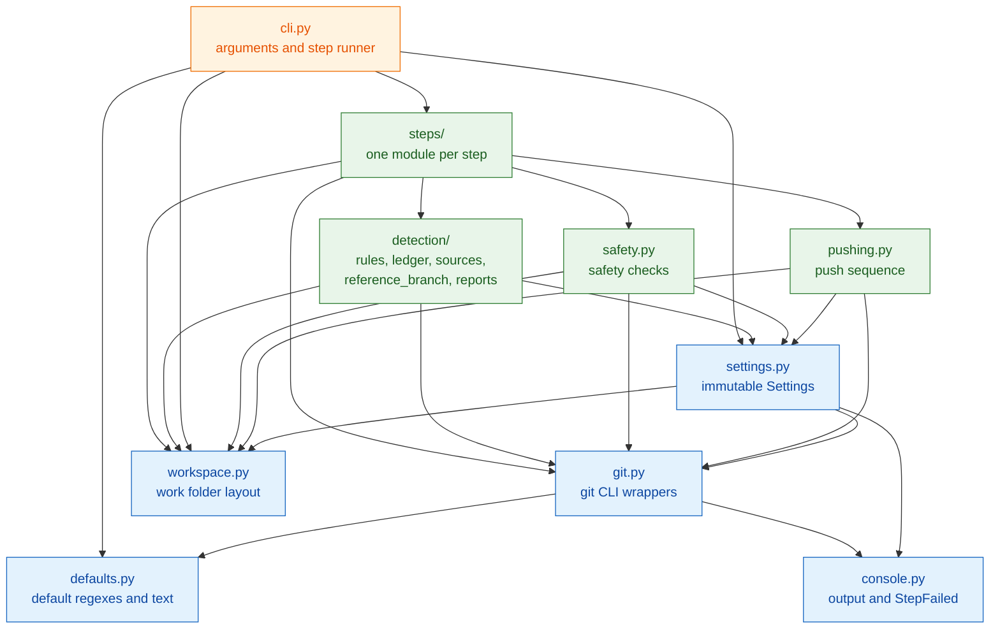

# Architecture: how git-history-purge works

git-history-purge removes leaked secrets from every commit of a git repository and then force-pushes the cleaned history. It does this in small steps, and each step is one module. This guide shows how the pieces fit together so you can find your way around quickly.

## The step pipeline

Steps run in order. Each step reads what the earlier one wrote into the work folder. `test` runs `fetch` to `rehearse` and never touches the real remote. `all` runs `test` and then `push`.

```mermaid
flowchart LR
    fetch["fetch<br/>mirror all branches and tags<br/>git.py, workspace.py"]
    find["find<br/>collect secret values<br/>detection/*"]
    rewrite["rewrite<br/>git filter-repo on a fresh copy<br/>git.py"]
    verify["verify<br/>0 values left, same refs<br/>safety.py, git.py"]
    rehearse["rehearse<br/>push to a local stand-in remote<br/>pushing.py, safety.py"]
    push["push<br/>real remote, typed PUSH<br/>pushing.py, safety.py"]
    cleanup["cleanup<br/>typed DELETE<br/>workspace.py"]

    fetch --> find --> rewrite --> verify --> rehearse --> push --> cleanup

    classDef safe fill:#e8f5e9,stroke:#2e7d32,color:#1b5e20
    classDef risky fill:#ffebee,stroke:#c62828,color:#b71c1c
    classDef tidy fill:#e3f2fd,stroke:#1565c0,color:#0d47a1

    class fetch,find,rewrite,verify,rehearse safe
    class push risky
    class cleanup tidy
```



Green steps never change the real remote. Red is the only step that does. Blue deletes the work folder that holds the original secrets.

## How the modules depend on each other

Arrows point from a module to the modules it uses. Lower layers never import from higher ones.



## Where to look

| Question | Where to look |
| --- | --- |
| Why was this value kept? | `detection/reference_branch.py` keeps values still in today's code. `detection/rules.py` (`classify_value`) skips placeholders, common words and local URLs. |
| Which files are scanned? | `detection/sources.py` for the collectors. The default config file names and ignored lock files are in `defaults.py`. |
| How does push stay safe? | `safety.py` (`check_history_is_clean`, `require_remote_unchanged_since_fetch`, `require_remote_matches_cleaned_copy`) and `pushing.py`. The rehearsal gate is in `steps/rehearse.py` and `steps/push.py`. |
| Where are reports written? | `detection/reports.py` writes them into the `reports/` folder of the work folder. |
| Where do the command-line options come from? | `cli.py` defines them and `settings.py` turns them into the `Settings` object. |
| How is the work folder laid out? | `workspace.py` (the `Workspace` class). |
| Where do PUSH and DELETE get asked for? | `console.py` (`require_typed_word`). |
| Where is git called? | `git.py` only. |

## The work folder

Every run keeps its files in one work folder (`purge-work/<repo-name>/` by default, or `--work-dir`). Folders that hold secrets are private (`0700`).

```text
purge-work/<repo-name>/
├── 1-original.git/               mirror of the remote, with the original secrets (fetch)
├── 3-cleaned.git/                rewritten copy with secrets replaced (rewrite)
├── 5-rehearsal-remote.git/       local stand-in for the real remote, removed after a pass (rehearse)
├── 5-rehearsal-fresh-clone.git/  fresh clone of the stand-in, re-checked, removed after a pass (rehearse)
├── secrets/                      collected secret values and the replacement list, private (find)
└── reports/                      key names and lengths only, never values (find onwards)
```

`cleanup` deletes the whole folder, because it holds the original secrets.

## Recipes

### Adding a detection source

1. Write a collector function in `detection/sources.py`. It receives what it needs (workspace, settings) and adds values to the `SecretLedger` from `detection/ledger.py`, with the source name, key and file.
2. Use `classify_value` from `detection/rules.py` so placeholders and common words are skipped the same way as everywhere else.
3. Call the new collector from `steps/find.py`.
4. If it needs a default list (file names, regexes), add it to `defaults.py`. If it needs a command-line option, add it in `cli.py` and `settings.py`.
5. Add a unit test in `tests/` using fake values.

### Adding a step

1. Create a module in `steps/` with a function that takes `Settings` and `Workspace` and does the work, ending with `fail()` from `console.py` when something is wrong.
2. Register it in `steps/__init__.py`, in `STEPS` (and in `COMBINED_STEPS` if it belongs to `test` or `all`).
3. Add new options in `cli.py` and `settings.py` if needed.
4. Reuse `workspace.py` for paths and `git.py` for git calls instead of calling git directly.
5. Add tests, a README mention and a line under Unreleased in `CHANGELOG.md`.

## Design principles

- **Never touch the real remote until the rehearsal passes.** `push` refuses to run without a passed rehearsal for the exact cleaned copy.
- **Reports never hold values.** They hold key names and lengths only.
- **One module per context.** Each step and each detection concern has its own small module.
- **Standard library only.** The tool shells out to git, git-filter-repo and gitleaks, and adds no Python dependencies.
